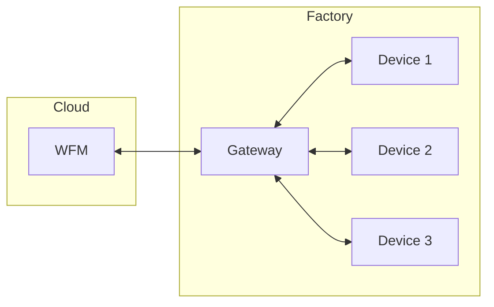
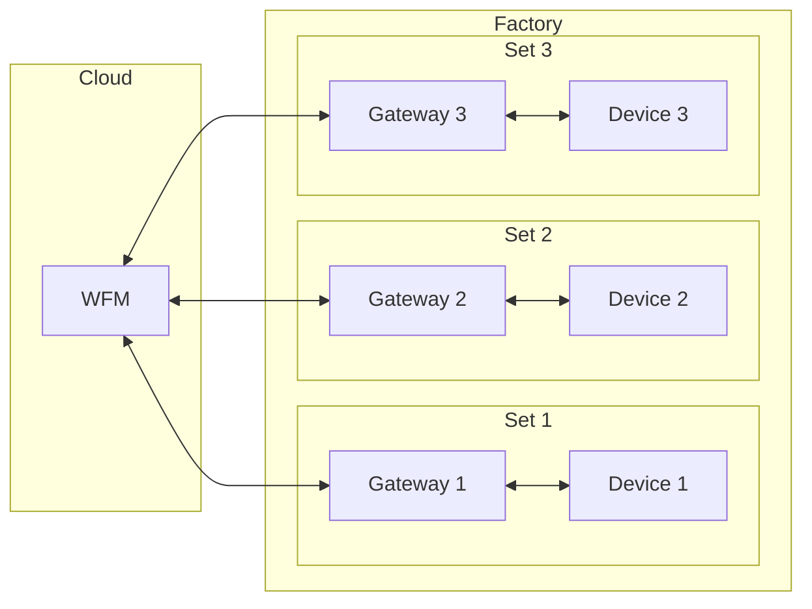
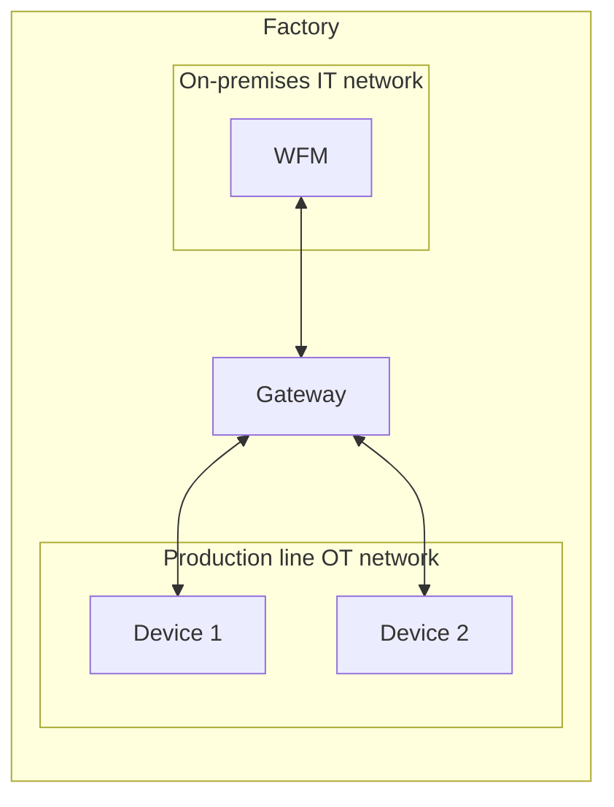

# Integration Patterns

This document describes how the Margo components can be deployed depending on the environment.

## Components

| Component | Description |
|-----------|-------------|
| WFM | Workload Fleet Manager. Manages applications and distributes them to devices. |
| Gateway | Lets one or several non-Margo devices connect to and be managed by a WFM, by translating the communication between them. It can run on a server, within a device, or on a dedicated device (a gateway device). In these patterns it is the only component that crosses a network boundary. |
| Device | An edge device that runs the deployed applications. Behind a Gateway it is a non-Margo device that is managed as a Margo device. A workload fleet management client is not required on a device behind a see-thru Gateway (see the [device requirements](https://github.com/margo/specification/blob/main/system-design/specification/margo-devices/device-requirements.md)). |

Per the [official documentation](https://docs.margo.org/concepts/gateways/gateways), Gateways are divided into three types:

- **Transparent**: not visible to the WFM. Provides a Margo client per downstream device, so each device appears as a Margo device.
- **See-thru**: visible to the WFM. Hosts a single Margo client for all downstream devices, and each device is still visible to the WFM with its own capabilities.
- **Opaque**: hides the downstream devices and appears to the WFM as a single Margo device with their combined capabilities.

The diagrams are written in [Mermaid](https://mermaid.js.org/) and rendered by GitHub.

## Pattern 1: Cloud WFM, one Gateway with multiple Devices

The WFM runs in the cloud. A single Gateway in the factory aggregates multiple Devices.

## Pattern 2: Cloud WFM, multiple Gateway-Device sets

The WFM runs in the cloud. The factory has multiple sets, and each Gateway is connected to exactly one Device.

## Pattern 3: Everything on-premises in the factory

The WFM, the Gateway and the Devices are all in the factory. The WFM is on the on-premises IT network and the Devices are on the OT network of the production line. A single Gateway bridges both networks.

